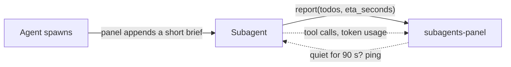

<div align="center">

# subagents-panel

**Stop staring at a spinner. See what every Claude Code subagent is doing — live, right beside the chat.**

[](LICENSE)
[](https://docs.claude.com/en/docs/claude-code)
[](https://github.com/rndbblnn/cc-mod-subagents-panel/tags)
[](https://github.com/rndbblnn/cc-mod-subagents-panel/stargazers)


<sub>A real screenshot. Three agents in parallel; the second delegates "Audit routes" to a child agent, drawn right under that task.</sub>

</div>

<br>

You hand Claude a big job. It fans out four subagents. Then you get… a spinner.

Which agent is stuck? Which one is almost done? How long until you get your terminal back? What is that one actually *doing*?

**subagents-panel** answers all of it at a glance. Every subagent gets a live card with its plan, a progress bar, an ETA, its token count and the exact command it's running right now. Child agents nest under the task that launched them. Finished ones tick green and get out of your way.

## Install

```
/plugin marketplace add rndbblnn/cc-mod-subagents-panel
/plugin install subagents-panel@rndbblnn-mods
```

Restart Claude Code. The next time a subagent starts, the panel opens on the right. No config, no API keys, works with every agent type.

## What you get


- **Every agent, one card.** Type and model, `done/total · elapsed · ETA · tokens`, and a full-width progress bar: yellow while it works, green when it's done.
- **The plan, not a spinner.** Each agent's ordered todos: `✓` done, `▸` current (with the live tool call, e.g. `Bash: cargo test`), `○` up next.
- **Real ETAs.** Agents estimate their own time left; when they don't, it's extrapolated from finished todos.
- **Nested delegation.** A child agent is drawn *under the exact todo* that spawned it, so fan-outs read like an outline.
- **Longest job on top.** Cards sort by ETA, so what you're waiting on is always first.
- **Session scoreboard.** A footer counts agents done, tasks done, what's still running, and failures.
- **Out of your way.** Finished cards leave after 10 s. The background is your terminal's own.

<br clear="right">

## Talk to your agents

Click a card (or tab to it and press <kbd>enter</kbd>):

| Key | Does |
| --- | --- |
| <kbd>m</kbd> | Message the agent: add a todo, change course, give it context |
| <kbd>e</kbd> | Ask for a fresh ETA and todo list now |
| <kbd>s</kbd> | Stop it *(experimental)* |
| <kbd>b</kbd> | Back to the list |

Every send tells you whether it was delivered, and why not when it wasn't.

## How it works



1. **Brief.** When any subagent starts, the panel appends one short paragraph to its prompt: *report your plan and ETA with `mcp__subagents-panel__report`.*
2. **Report.** The agent sends its ordered todo list and ETA as it goes. One small tool call per todo.
3. **Watch.** The panel also follows the agent's tool calls and token usage by itself, so you see what it's running even between reports.
4. **Nudge.** An agent that goes quiet for 90 s gets a one-line status ping.

One hooks module on Claude Code's mod API. No background process, no network, nothing outside your session.

## Commands

| Command | Does |
| --- | --- |
| `/subagents` | Show or hide the panel |
| `/subagents open` | Bring it forward |
| `/subagents clear` | Drop finished cards now |

## Configure

All optional. Set them in `/config`, or in `~/.claude/settings.json`:

```json
{ "pluginConfigs": { "subagents-panel": { "options": { "pingSeconds": 90, "keepFinishedSeconds": 10 } } } }
```

| Option | Default | What it does |
| --- | --- | --- |
| `autoOpen` | `true` | Open the panel when any subagent starts |
| `pingSeconds` | `90` | Ping an agent that hasn't reported for this long. `0` = never |
| `keepFinishedSeconds` | `10` | How long finished cards stay. `0` = until `/subagents clear` |

## FAQ

**The panel didn't open by itself.**
Claude Code only auto-opens side panels on a terminal at least **144 columns** wide (110 once you've opened it yourself). Narrower, the status line shows `⚙ 2 subagents running · /subagents`. Type `/subagents` and it opens at any width.

**An agent never shows todos.**
Custom agents with a `tools:` allowlist need the report tool listed:

```yaml
tools: [Read, Grep, Bash, mcp__subagents-panel__report]
```

Without it the card still shows the live tool call and tokens, just no plan.

**Does it cost tokens?**
One short paragraph per agent and one small tool call per todo. Pings only go to agents that have been silent for 90 s.

**What about read-only agents like `Plan` and `Explore`?**
They report like any other. They may still refuse to run commands they can't verify as read-only; that's them, not the panel.

## Develop

```
git clone https://github.com/rndbblnn/cc-mod-subagents-panel && cd cc-mod-subagents-panel
claude plugin validate .
claude plugin test .              # unit + render tests
claude --plugin-dir .             # a session with your checkout loaded
```

Logic lives in [`hooks/model.ts`](hooks/model.ts) (pure, unit-tested); [`hooks/register.tsx`](hooks/register.tsx) wires it to Claude Code. [`CLAUDE.md`](CLAUDE.md) has the gotchas.

## Credits

Inspired by [savvy-progress](https://github.com/johnnyvizz/claude-kit/tree/main/plugins/savvy-progress) by [@johnnyvizz](https://github.com/johnnyvizz). Written from scratch.

MIT © [rndbblnn](https://github.com/rndbblnn)
