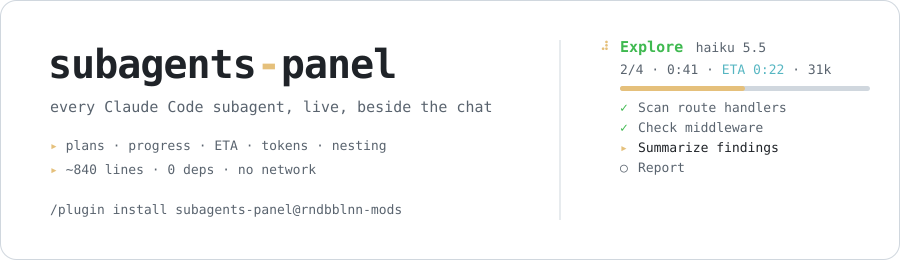
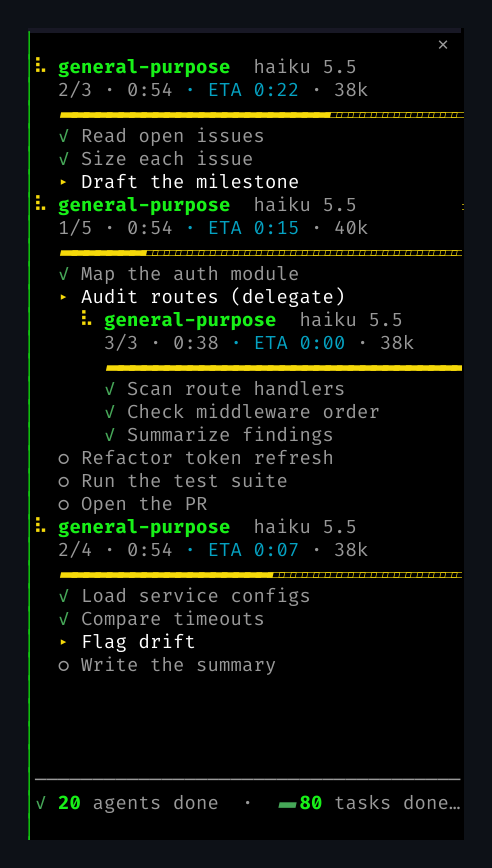
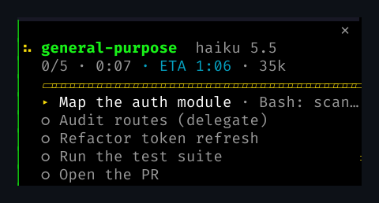
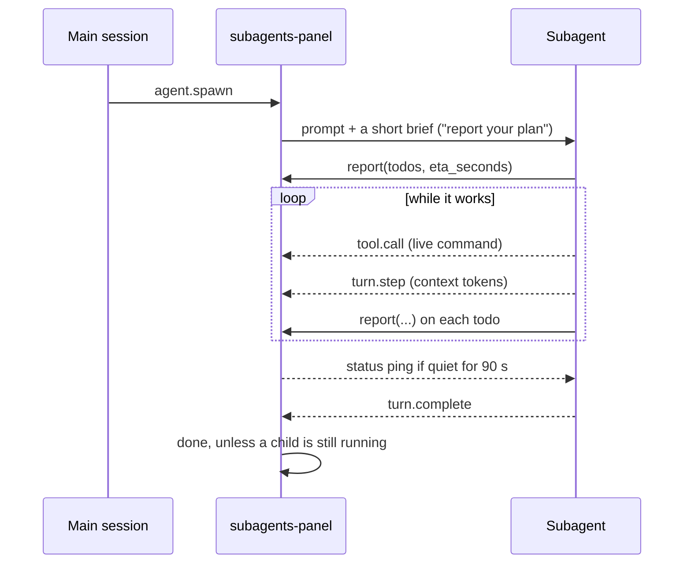

<div align="center">

<picture>
  <source media="(prefers-color-scheme: dark)" srcset="assets/banner-dark.svg">
  <source media="(prefers-color-scheme: light)" srcset="assets/banner-light.svg">
  
</picture>

### Your subagents, out of the black box.

**A live panel for every Claude Code subagent: its plan, progress, ETA, tokens and the command it's running right now, with child agents nested under the task that spawned them.**

[](LICENSE)
[](https://docs.claude.com/en/docs/claude-code)
[](https://github.com/rndbblnn/cc-mod-subagents-panel/tags)


**[Install](#install-30-seconds)** · **[Anatomy](#anatomy-of-a-card)** · **[How it works](#how-it-works)** · **[Limits](#evidence-and-limits)** · **[FAQ](#faq)**

<br>



<sub>Real screenshot, not a mockup. Three agents in parallel; the middle one delegated "Audit routes" to a child agent.</sub>

</div>

<br>

Claude fans out four subagents and hands you a spinner. Which one is stuck? Which is almost done? How long until you get your terminal back?

**subagents-panel** turns that spinner into a live dashboard, docked beside the chat. No API keys, no server, no config.

## Is it for you?

- You run **parallel subagents** (`Explore`, `Plan`, your own) and want to know what each one is doing.
- You build **agent workflows** where agents delegate to agents, and want to see the tree.
- You want **ETAs and token counts** without reading transcripts.

If you mostly run one agent at a time, you don't need this.

## Install (30 seconds)

```
/plugin marketplace add rndbblnn/cc-mod-subagents-panel
/plugin install subagents-panel@rndbblnn-mods
```

Restart Claude Code. The next subagent opens the panel on the right.

## Anatomy of a card



```
⠼ general-purpose  haiku 5.5      spinner · agent type · model
  1/5 · 0:54 · ETA 0:15 · 40k     todos done · elapsed · ETA · context
  ▰▰▰▰▰▰▱▱▱▱▱▱▱▱▱▱▱▱▱▱▱▱▱▱▱       yellow while running, green when done
  ✓ Map the auth module           done
  ▸ Audit routes (delegate)       current task
      ⠧ general-purpose  haiku    a child agent, nested under
        3/3 · 0:38 · 38k          the task that spawned it
  ○ Refactor token refresh        up next
──────────────────────────────
✓ 20 agents done · ▰ 80 tasks     session scoreboard
```

<br clear="right">

- **Sorted by ETA**, longest first, so what you're waiting on is always on top.
- **Live tool call** next to the current task: `▸ Run the test suite · Bash: cargo test`.
- **Finished cards leave after 10 s.** The background is your terminal's own.

## Talk to your agents

Click a card (or tab to it and press <kbd>enter</kbd>):

| Key | Action |
| --- | --- |
| <kbd>m</kbd> | Message the agent: add a todo, change course, give it context |
| <kbd>e</kbd> | Ask for a fresh ETA and todo list now |
| <kbd>s</kbd> | Stop it *(experimental, see [limits](#evidence-and-limits))* |
| <kbd>b</kbd> | Back to the list |

Every send reports whether it was delivered, and why not when it wasn't.

## How it works

The panel is one hooks module on Claude Code's mod API. It never polls a transcript or calls a model; it listens to seven engine events.



| Hook | What the panel does with it |
| --- | --- |
| `agent.spawn` | Appends the brief, adds a card, records the parent's current todo. A repeat spawn is a resume: the card is revived, not reset |
| `tool.call` · `report` | Stores the ordered todos and ETA |
| `tool.call` · any other | Shows the live call (`Bash: cargo test`), counts calls |
| `turn.step` | Reads usage: input + cache + output = context tokens |
| `turn.complete` | Marks the agent done, unless one of its own children still runs (it's waiting) |
| `ui.render` · `Pane` | Draws the tree: cards fit whole, top first, children nested under their todo |
| `session.start` | Registers the tool and `/subagents`, starts a 1 s tick for spinners, pings, cleanup and a reconcile against `$.agent.list()` |

**ETA**: the agent's own `eta_seconds` when it gave one; otherwise `elapsed / done × remaining` from finished todos; otherwise none. Never invented.

## Small enough to read

| File | Lines | What's in it |
| --- | --: | --- |
| [`hooks/model.ts`](hooks/model.ts) | 291 | Pure logic: tree, sort, ETA, ping schedule, totals. No I/O, fully unit-tested |
| [`hooks/register.tsx`](hooks/register.tsx) | 494 | The seven hooks and the JSX the panel draws |
| [`types/index.d.ts`](types/index.d.ts) | 53 | The state contract: `Run`, `Todo`, `Totals` |

Zero runtime dependencies: every import is from Claude Code itself. No background process, no network, no files written. State lives in the session (`$.state`) and dies with it.

## Evidence and limits

What's verified, and what isn't:

- ✅ **Plans, progress, ETA, tokens, nesting, sorting, cleanup, footer**: verified in live sessions with parallel and nested agents, plus 23 unit and render tests.
- ⚠️ **Stop** uses `TaskStop` through the mod's tool-call API, which isn't a documented mod surface. If Claude Code refuses it, a toast says why.
- ⚠️ **Status pings** (`$.session.send`) haven't been confirmed delivered in live testing yet. A ping that fails now says so in a toast, with the reason.
- **ETAs are estimates.** An agent's guess can be wrong; the panel shows it, it doesn't vouch for it.
- **Auto-open needs width.** Claude Code only opens a side panel by itself on a terminal ≥ 144 columns (≥ 110 once you've opened it by hand). Narrower, use `/subagents`.
- **No scrolling yet.** Cards fit top-first; more agents than fit wait below until others finish.
- **The mod API is early access** and may change between Claude Code releases.

## Commands and options

| Command | |
| --- | --- |
| `/subagents` | Show or hide the panel |
| `/subagents open` | Bring it forward |
| `/subagents clear` | Drop finished cards now |

| Option | Default | |
| --- | --- | --- |
| `autoOpen` | `true` | Open the panel when any subagent starts |
| `pingSeconds` | `90` | Ping an agent quiet for this long. `0` = never |
| `keepFinishedSeconds` | `10` | How long finished cards stay. `0` = until `/subagents clear` |

Set them in `/config`, or in `~/.claude/settings.json`:

```json
{ "pluginConfigs": { "subagents-panel": { "options": { "pingSeconds": 90, "keepFinishedSeconds": 10 } } } }
```

## FAQ

<details>
<summary><b>The panel didn't open by itself.</b></summary>
<br>

Your terminal is narrower than 144 columns. The status line shows `⚙ 2 subagents running · /subagents`; type `/subagents` and the panel opens at any width. After that, it opens by itself from 110 columns.
</details>

<details>
<summary><b>An agent never shows todos.</b></summary>
<br>

Custom agents with a `tools:` allowlist need the report tool:

```yaml
tools: [Read, Grep, Bash, mcp__subagents-panel__report]
```

Without it the card still shows the live tool call and tokens, just no plan.
</details>

<details>
<summary><b>Does it cost tokens?</b></summary>
<br>

One short paragraph appended to each subagent's prompt, plus one small tool call per todo. Pings only go to agents silent for `pingSeconds`.
</details>

<details>
<summary><b>Does it work with <code>Plan</code>, <code>Explore</code> and my own agents?</b></summary>
<br>

Yes, with any agent type, built-in or custom, at any nesting depth.
</details>

<details>
<summary><b>Does it send anything anywhere?</b></summary>
<br>

No. It runs inside your Claude Code session, makes no network calls and writes no files.
</details>

## Repository layout

```
.claude-plugin/
  plugin.json        manifest + options
  marketplace.json   makes the repo installable with /plugin
hooks/
  hooks.json         points Claude Code at register.tsx
  register.tsx       the hooks and the drawing
  model.ts           pure logic
  *.test.ts(x)       claude plugin test
types/index.d.ts     state contract
CLAUDE.md            notes and gotchas for contributors (and their agents)
```

## Develop

```
git clone https://github.com/rndbblnn/cc-mod-subagents-panel && cd cc-mod-subagents-panel
claude plugin validate .
claude plugin test .
claude --plugin-dir .      # a session with your checkout loaded
```

Issues and PRs welcome. [`CLAUDE.md`](CLAUDE.md) lists the gotchas we hit building it.

## Credits

Inspired by [savvy-progress](https://github.com/johnnyvizz/claude-kit/tree/main/plugins/savvy-progress) by [@johnnyvizz](https://github.com/johnnyvizz). Written from scratch.

<div align="center">
<br>

**If it saved you a stare at a spinner, a ⭐ helps others find it.**

MIT © [rndbblnn](https://github.com/rndbblnn)

</div>
